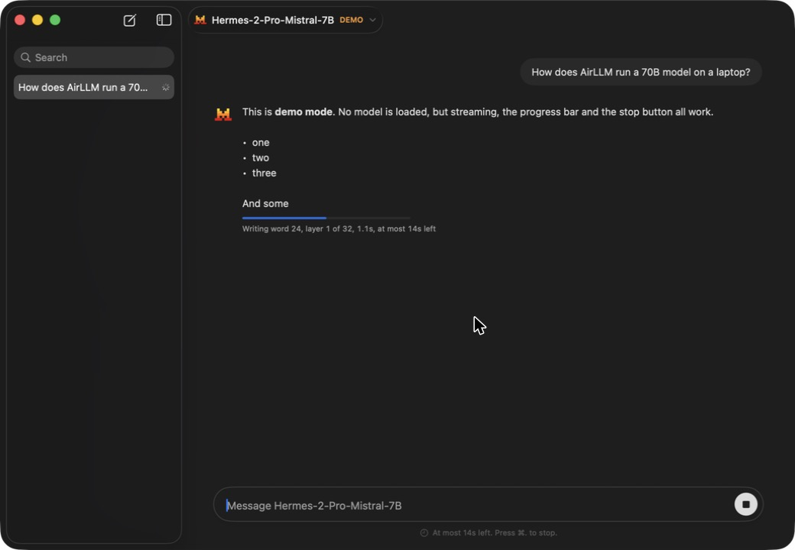
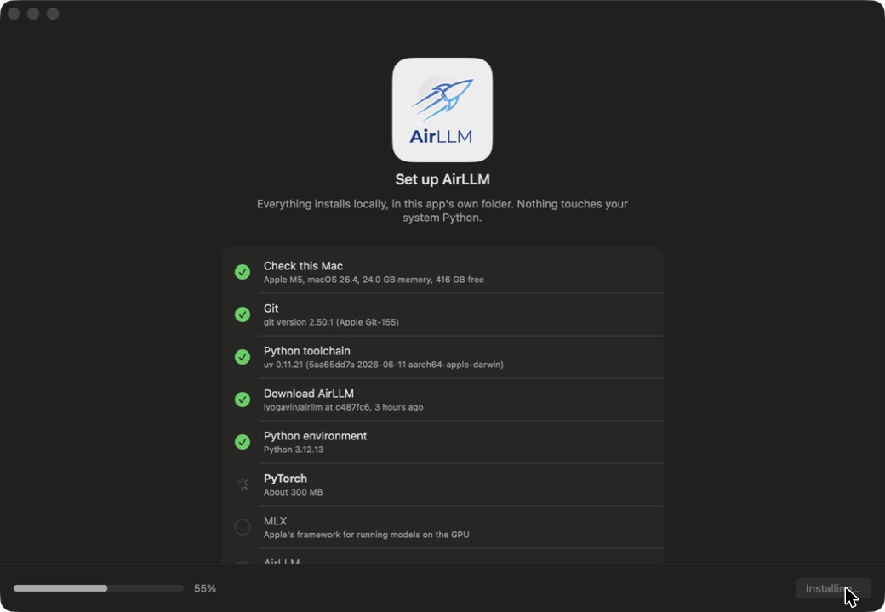
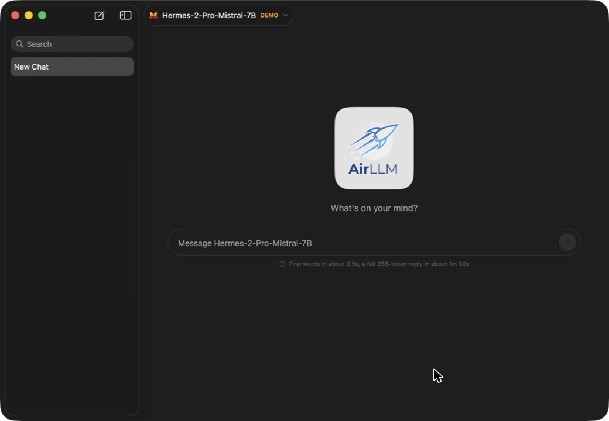
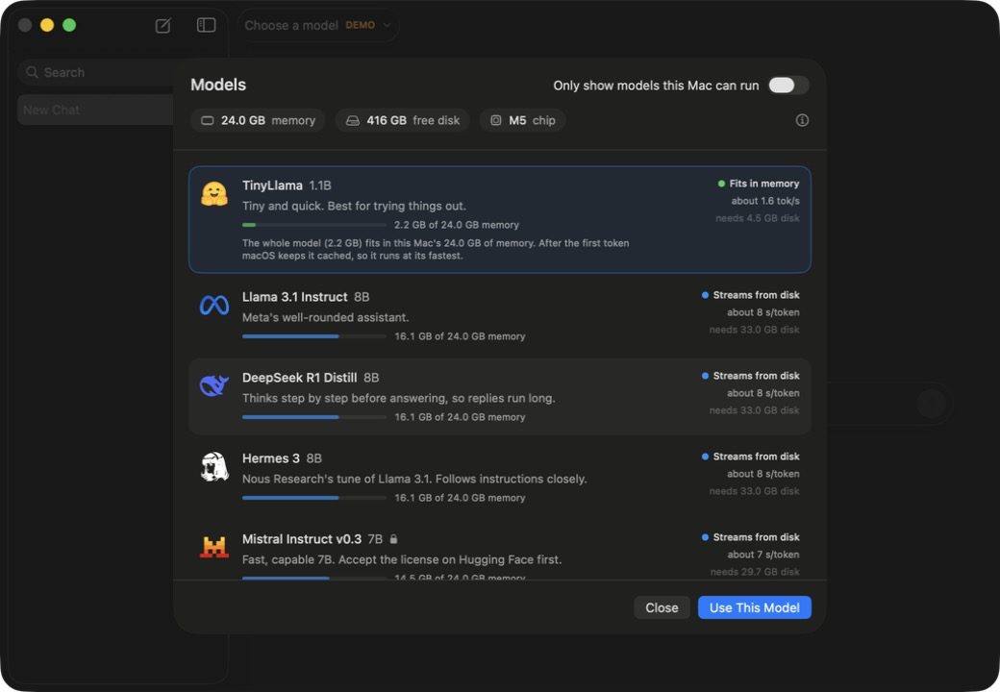
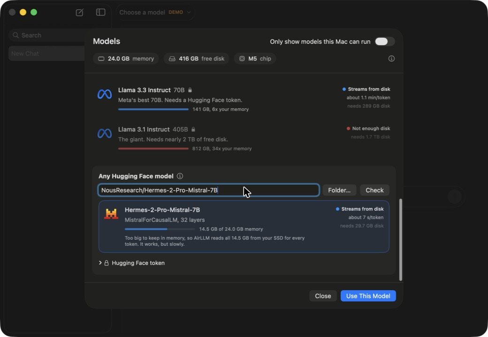
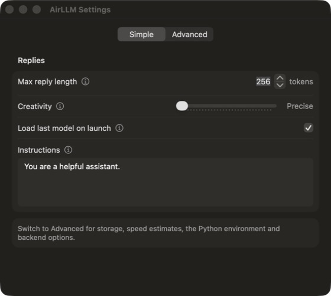
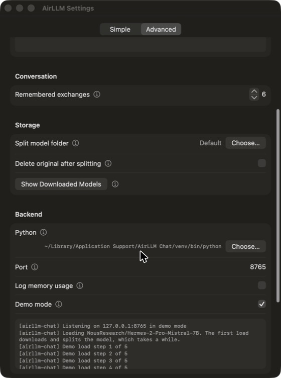
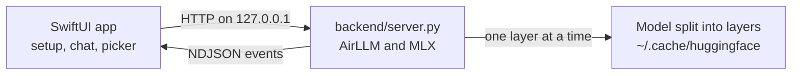

<p align="center">
  
</p>

<h1 align="center">AirLLM for Mac</h1>

<p align="center">
  A native SwiftUI chat app that installs <a href="https://github.com/lyogavin/airllm">AirLLM</a> for you and runs models bigger than your Mac's memory, right on your Mac.
</p>

<p align="center">
  
  
  
</p>

AirLLM runs large language models by reading them from disk one layer at a time, so a 70B model can run on a laptop with 16 GB of memory. It's a Python library with no interface of its own. This app gives it one: a clean chat window, a one-click installer, a model picker that tells you what fits on your Mac, and a time estimate for every reply.

## Screenshots

<p align="center">
  
</p>

<table>
  <tr>
    <td width="50%"><br><sub><b>Setup.</b> Clones AirLLM from GitHub and installs PyTorch, MLX and AirLLM into a private environment, step by step.</sub></td>
    <td width="50%"><br><sub><b>New chat.</b> The line under the box says how long the first words and a full reply will take.</sub></td>
  </tr>
  <tr>
    <td width="50%"><br><sub><b>Model picker.</b> Every model shows its size against your memory, whether it fits, its speed and the disk it needs.</sub></td>
    <td width="50%"><br><sub><b>Fit check.</b> Paste any Hugging Face repo to see whether AirLLM can run it on this Mac.</sub></td>
  </tr>
  <tr>
    <td width="50%"><br><sub><b>Settings.</b> Simple mode covers the basics. Every setting has an info button that explains what it does.</sub></td>
    <td width="50%"><br><sub><b>Advanced.</b> Storage, chat memory, the Python environment, the backend and its log.</sub></td>
  </tr>
</table>

<sub>Screenshots were taken in demo mode, which streams a placeholder reply without loading a model.</sub>

## What it does

- **One-click setup.** On first launch the app checks your Mac and Git, clones `lyogavin/airllm`, makes a private Python 3.12 environment and installs PyTorch, MLX and AirLLM, showing each step. Running it again pulls the latest AirLLM and skips anything already installed.
- **Fit testing.** The picker reads your Mac's memory and free disk and rates each model as *Fits in memory*, *Streams from disk* or *Not enough disk*, with an estimated speed. It can also check any Hugging Face repo by reading its `config.json`.
- **Reply time estimates.** Before you send, it shows the time to first words and to a full reply. While a reply is written, it shows the current layer and an upper bound on the time left. Estimates start from model size and switch to your Mac's measured speed after the first reply.
- **Chat.** Streaming replies, chats saved locally, search, Stop (⌘.), Regenerate (⌘R) and code blocks you can copy.
- **Real provider logos** for Meta, DeepSeek, Mistral, Nous Research, 01.AI and Hugging Face.
- **Simple and Advanced settings**, each with an info button explaining what it really changes.

## How it works

The app is a SwiftUI front end for a small Python server. Setup creates the server's Python environment, and the app starts the server and talks to it over `127.0.0.1:8765`.



- **The server** loads models with `airllm.AutoModel`, which on macOS is AirLLM's MLX code running on the GPU. It patches AirLLM's layer loop to report progress per layer and to support Stop. It also applies temperature, which AirLLM's Mac code path ignores.
- **Every token is a full pass over the model.** AirLLM loads each layer from disk, runs it and frees it. A model that fits in memory stays in macOS's file cache after the first token and runs much faster. A bigger model is read from the SSD for every token.
- **The fit test** puts peak memory at the largest layer plus runtime overhead, disk at the download plus AirLLM's split copy, and speed at model size divided by read throughput. Real replies replace the throughput guess with measured numbers.
- **Replies stream** as newline-delimited JSON: `progress` events per layer, `token` events with text, then `done` with stats or `error`.

Where things live:

| What | Where |
| --- | --- |
| AirLLM source (git clone) | `~/Library/Application Support/AirLLM Chat/airllm` |
| Python environment | `~/Library/Application Support/AirLLM Chat/venv` |
| Chats | `~/Library/Application Support/AirLLM Chat/conversations.json` |
| Downloaded models | `~/.cache/huggingface/hub`, or your chosen split folder |
| Hugging Face token | macOS Keychain |

**Limits.** On macOS, AirLLM runs Llama and Mistral style models without tied embeddings. Its 4-bit and 8-bit compression needs `bitsandbytes`, which doesn't run on Mac, so the app doesn't offer it.

### Project layout

```
Sources/AirLLMMac/
  App/            entry point, menus, app state, root view
  Core/           models, persistence, settings, system info, formatting
  Features/
    Backend/      starts server.py, HTTP client, event parsing
    Setup/        installer steps and the setup screen
    Models/       catalog, fit analysis, Hugging Face check, picker views
    Chat/         conversations, reply flow, time estimates, chat views
    Settings/     Simple and Advanced settings views
  Shared/Views/   logos, info button, log view
backend/          the Python server, split by job
Tests/
  AirLLMMacTests/ Swift tests
  backend/        Python tests
Resources/        AirLLM logo and provider logos
Scripts/          build_app.sh, make_icon.swift
```

## Getting started

You need a Mac with Apple silicon, macOS 14 or later, and Xcode or the Command Line Tools. The app's setup installs everything else.

Build the app and install it into `~/Applications`:

```bash
./Scripts/build_app.sh
```

Open it:

```bash
open ~/Applications/AirLLM.app
```

On first launch, click **Install** and wait for every step to turn green, then click **Start Chatting**. Pick a model. TinyLlama is a 2.2 GB download and the quickest way to see it work.

To try the interface without downloading a model, turn on **Demo mode** in Settings, Advanced, then choose **Model > Restart Backend**.

### Developing

Run the app without bundling it:

```bash
swift run AirLLMMac
```

Pass `--auto-setup` to start setup without clicking Install, which helps when testing setup.

Run the Swift tests:

```bash
swift test
```

Run the Python tests with the environment setup created:

```bash
~/Library/Application\ Support/AirLLM\ Chat/venv/bin/python -m unittest discover -s Tests/backend
```

## Credits

[AirLLM](https://github.com/lyogavin/airllm) by Gavin Li (Apache-2.0). Provider logos from [LobeHub Icons](https://github.com/lobehub/lobe-icons). Model names and logos belong to their owners.
